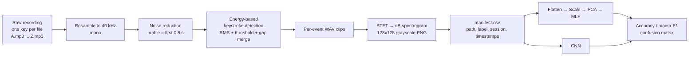

# KeySense AI — Acoustic Keystroke Recognition

> **FOML (Foundations of Machine Learning) course project.**
> Can a machine tell *which keyboard key* was pressed just by listening to it?
> KeySense AI records typing audio, isolates each keystroke, converts it to a spectrogram image, and classifies it into one of 26 letters (A–Z) with a classical ANN and a CNN.

**Authors:** `TODO: names` · **Course / Term:** `TODO` · **Last updated:** November 2026

---

## Table of contents

1. [Project at a glance](#1-project-at-a-glance)
2. [Pipeline](#2-pipeline)
3. [Repository contents](#3-repository-contents)
4. [Data](#4-data)
5. [Signal processing details](#5-signal-processing-details)
6. [Models](#6-models)
7. [Results](#7-results)
8. [Key findings](#8-key-findings)
9. [Current limitations (please read)](#9-current-limitations-please-read)
10. [Known issues in the notebooks](#10-known-issues-in-the-notebooks)
11. [Roadmap](#11-roadmap)
12. [How to run](#12-how-to-run)
13. [Interview talking points](#13-interview-talking-points)
14. [Ethics and responsible use](#14-ethics-and-responsible-use)

---

## 1. Project at a glance

| | |
|---|---|
| **Task** | 26-class classification: which letter key (A–Z) produced a given keystroke sound |
| **Input** | Audio recordings (MP3), one file per key, each containing ~20–40 presses of that key |
| **Representation** | Per-keystroke grayscale log-magnitude spectrogram, 128 × 128 px |
| **Models** | (a) MLP/ANN on flattened pixels, with and without PCA; (b) 3-block CNN |
| **Best within-session result** | **CNN ≈ 86–87 % accuracy** (random chance = 3.85 %) |
| **Cross-session (true generalisation) result** | **Not yet measured**, see [limitations](#9-current-limitations-please-read) |
| **Stack** | Python, librosa, noisereduce, NumPy, pandas, scikit-learn, TensorFlow/Keras, matplotlib, seaborn |

---

## 2. Pipeline



**Labelling strategy:** the label of every clip is the filename of the recording it came from (`Q.mp3` → `Q`). There is no manual per-clip annotation, which makes data collection fast but has consequences (see [limitations](#9-current-limitations-please-read)).

---

## 3. Repository contents

| File | Purpose |
|---|---|
| `SoundToSonoGraph_fixed.ipynb` | **Data pipeline.** Loads recordings, applies noise reduction, detects keystroke events, saves per-event WAVs and spectrogram PNGs, writes `manifest.csv`. Includes plots to inspect the waveform and to compare noise-reduction strengths (0.3 / 0.6 / 1.0). |
| `Main.ipynb` | **Baseline experiments on the original dataset** (750 spectrograms): label assignment, train/test split, ANN + PCA, ANN without PCA, CNN, confusion matrices, training curves. |
| `Main_session2_evaluation.ipynb` | Same experiments re-run on the reprocessed Session 1 manifest (805 clips) and on the larger Session 2 dataset (3,070 clips). Saves the trained CNN and label encoder to `models/`, then evaluates the saved CNN on Session 2. |
| `KeySense_Session2_Train_Session1_Test.ipynb` | **Cross-session test (work in progress):** loads the CNN trained on Session 2 and tests it on Session 1 recordings it has never seen. See [known issues](#10-known-issues-in-the-notebooks). |
| `README.md` | This file |

Folders created at run time (not committed, because of size and privacy of audio):

```
data/
  session1/   A.mp3 ... Z.mp3          # raw recordings (input)
  session2/   A.mp3 ... Z.mp3
dataset/
  session1/ | session2/
    detected/<KEY>/event_###.wav        # isolated keystrokes
    spectrogram_images/<KEY>/event_###.png
    manifest.csv
models/
  keysense_cnn.keras                    # saved CNN
  keysense_label_encoder.joblib         # class ↔ index mapping
```

`manifest.csv` columns: `image_path, audio_path, source_recording, label, session_id, start_seconds, end_seconds`.

---

## 4. Data

### Collection protocol

Each key was pressed repeatedly in its own recording (e.g. `A.mp3` is ~32 s of the A key being pressed about 30 times). 26 recordings per session.

`TODO: fill in. Interviewers will ask about this: keyboard model and type (mechanical/membrane/laptop), microphone and distance, room, typing style and number of typists, sampling/bit rate of the source MP3s.`

### Dataset versions

| Version | Source | Clips | Per-key range | Used in |
|---|---|---|---|---|
| **Original** | first pass of Session 1 audio | **750** | 17 (F) – 41 (X) | `Main.ipynb` |
| **Session 1 (reprocessed)** | same recordings, re-run through the fixed pipeline | **805** | 17 (F) – 84 (Q) | `Main_session2_evaluation.ipynb` (ANN part), cross-session test |
| **Session 2** | second set of recordings | **3,070** | 79 (N) – 156 (C) | CNN training and evaluation |

Note: 25 of the 26 keys have exactly the same clip counts in the original and reprocessed Session 1 sets. Only **Q jumps from 29 to 84 clips**. This strongly suggests the detector over-segmented that one recording (e.g. splitting presses or picking up noise) and that the extra Q clips may be unreliable. It has not been verified by listening.

### Class balance

Session 1 is mildly imbalanced (F = 17 vs X = 41, or Q = 84 after reprocessing). Splits are **stratified**, and macro-F1 and balanced accuracy are reported alongside accuracy.

---

## 5. Signal processing details

All parameters come from `SoundToSonoGraph_fixed.ipynb`.

**Loading and denoising**
- Resample to **40 kHz**, mono (`librosa.load`).
- `noisereduce.reduce_noise` with `prop_decrease = 1.0`, using the **first 0.8 s of each recording as the noise profile** (assumes the recording starts with silence).

**Keystroke detection (`find_active_events`)**
- Short-time RMS energy, frame 512 samples, hop 128.
- Threshold = `max(3.0 × 40th-percentile RMS, 0.04 × peak RMS)`.
- Gaps shorter than **0.12 s** are merged, so the press and release bursts of one stroke form a single event.
- Events shorter than **25 ms** are discarded.
- Each clip is padded with **0.10 s before** and **0.18 s after** the event.

**Spectrogram (`save_spectrogram`)**
- STFT with `n_fft = 512`, `hop_length = 128`, converted to dB relative to the clip's own maximum.
- Rendered as a borderless grayscale image, 1.28 in × 100 dpi = **128 × 128 px**, no axes or colourbar.

**Model input**
- Image → grayscale → resize to 128 × 128 → divide by 255.
- ANN: flattened to a **16,384-dimensional** vector. CNN: kept as a 128 × 128 × 1 tensor.

---

## 6. Models

### A. ANN (scikit-learn `MLPClassifier`)

```
16,384 px → StandardScaler → PCA (keep 95 % variance) → MLP (256 → 128, ReLU, Adam, α = 1e-3, batch 32, early stopping)
```
PCA reduces 16,384 features to **243** components on the 750-clip set and **310** on the 805-clip set. A second variant skips scaling and PCA and trains the MLP (256, 128) on raw pixels.

### B. CNN (TensorFlow/Keras)

```
Input 128×128×1
Conv2D(32,3×3) → MaxPool
Conv2D(64,3×3) → BatchNorm → MaxPool
Conv2D(128,3×3) → MaxPool
Flatten (32,768) → Dense(128, ReLU) → Dropout(0.4) → Dense(26, softmax)
```
- **4,290,714 parameters**, of which 4,194,432 (about 98 %) sit in the first Dense layer after Flatten.
- Adam, sparse categorical cross-entropy, batch 32, up to 40 epochs, `EarlyStopping(val_loss, patience = 5, restore_best_weights)`, 15 % of the training set held out for validation.

### Evaluation setup
- Stratified 80/20 split, `random_state = 42`.
- Scaler and PCA are **fit on the training set only** (no preprocessing leakage).
- Metrics: accuracy, macro-F1, balanced accuracy, per-key precision/recall/F1, confusion matrix.

---

## 7. Results

### 7.1 Main results

| # | Dataset (test size) | Model | Accuracy | Macro-F1 | Train time |
|---|---|---|---|---|---|
| 1 | Original, 750 (n = 150) | ANN + PCA (243 comps) | 77.3 % | 0.767 | 1.4 s |
| 2 | Original, 750 (n = 150) | ANN, raw pixels | 84.0 % | 0.836 | 10.3 s |
| 3 | Original, 750 (n = 150) | **CNN** | **86.0 %** | **0.854** | 83.7 s |
| 4 | Session 1, 805 (n = 161) | ANN + PCA (310 comps) | 75.2 % | 0.735 | 1.4 s |
| 5 | Session 1, 805 (n = 161) | ANN, raw pixels | 86.3 % | 0.851 | 11.2 s |
| 6 | Session 2, 3,070 (n = 614) | **CNN** | **87.0 %** | **0.871** | 273.8 s |

Chance level for 26 classes is 3.85 %.

Row 6 comes from two runs of the same notebook cell, which gave **88.6 % / 0.887** and **87.0 % / 0.871**. The TensorFlow seed is not fixed, so about **±1.5 points of run-to-run variance** should be assumed.

### 7.2 A number that should *not* be quoted as generalisation

`Main_session2_evaluation.ipynb` ends with "evaluate the saved CNN on Session 2" and reports **95.1 % accuracy / 0.951 macro-F1 on all 3,070 images**. This is **not an unseen-data result**: the CNN was trained on 80 % of exactly this manifest, so 2,456 of those 3,070 images were training data. The honest held-out figure for that model is the 87.0 % in row 6.

### 7.3 Per-key behaviour
- Easy keys (F1 ≥ 0.9 in the original CNN run): B, F, N, D, J, I, T, V, W, X, Z, Q, O, A.
- Hard keys in the original run: **H (F1 0.44 CNN / 0.22 ANN+PCA)**, **R (0.60)**, **U (0.67)**, **L (0.67)**, **K (0.36 ANN+PCA / 0.73 CNN)**.
- With only 3–8 test clips per key in the original split, each per-key score rests on very few samples; treat them as indicative, not conclusive.

### 7.4 Statistical precision
A 95 % binomial confidence interval is roughly **±5.5 points** for 86 % on 150 test clips, and **±2.7 points** for 87 % on 614 clips. The ANN-vs-CNN gap on the 150-clip set (84.0 vs 86.0) is therefore within noise; the PCA penalty (about 7–11 points) is not.

---

## 8. Key findings

1. **Keystrokes are acoustically distinguishable.** Even a simple MLP on pixels reaches 75–86 %, far above the 3.85 % chance level.
2. **The CNN edges out the MLP on the same data (86 vs 84 % on the original set)**, but the margin is small relative to the test-set size. Training the CNN costs about 8× more time than the raw-pixel ANN.
3. **PCA at 95 % variance hurt the ANN** by roughly 7 points on the original set and 11 points on the 805-clip set. Likely explanation: the discriminative detail in a spectrogram sits in low-variance directions that PCA discards, and per-pixel standardisation amplifies noise. *Caveat:* the "with PCA" and "without PCA" ANNs also differ in scaling and in several hyperparameters (batch size, α), so this comparison is not perfectly controlled.
4. **More data helped the CNN reach a more stable 87 %** with ~4× the data and a 4× larger test set, but the cleanliness of that data is unverified.
5. **Training on one session and testing within that same session overestimates real-world performance** (this is why the cross-session notebook exists).

---

## 9. Current limitations (please read)

Ordered roughly by how much they affect the validity of the headline numbers.

### Evaluation validity
1. **No true cross-session or cross-recording evaluation yet.** All reported test accuracies split clips *randomly* from the same recordings. Clips from one recording share microphone position, background noise, keyboard state, and the noise-reduction artefacts of that file, and consecutive presses are near-duplicates. The classifier may partly learn *"which recording is this?"* rather than *"which key is this?"*. Because each key was recorded in its own file, **key identity and recording identity are perfectly confounded**, and a random split cannot separate them.
2. **The 95.1 % "Session 2 evaluation" figure is contaminated** by training data (see 7.2).
3. **The cross-session notebook has not completed a successful run** (see [known issues](#10-known-issues-in-the-notebooks)).
4. **Single seed, single split, no cross-validation, no confidence intervals in the notebooks.** Small test sets (3–8 clips per key in the original split) make per-key numbers noisy.
5. **No hyperparameter search.** Architecture and settings were chosen once; this is mostly a strength for leakage-avoidance but means the models are likely not at their ceiling.

### Data
6. **Weak labels.** Labels come from filenames, not from verified keystrokes. Missed presses, double-detected presses, a stray cough, or room noise are all silently labelled as the key being recorded. The Q jump (29 → 84 clips) is a visible symptom.
7. **Small dataset.** Hundreds of clips per version, ~30 per key in Session 1. This is small for a 4.3 M-parameter CNN, and the CNN has **no data augmentation** (no time shift, noise injection, SpecAugment, etc.).
8. **Narrow recording conditions.** One keyboard, one environment, (to be confirmed) one typist. Nothing here shows the model works on another keyboard, microphone, room, or person.
9. **Isolated, deliberate presses only.** Each recording is one key pressed repeatedly with pauses. Real typing has overlapping keystrokes, varying rhythm and speed, shift/space/enter/backspace keys, and digits/punctuation. None of that is covered; the label set is A–Z only.
10. **Source audio is lossy MP3**, which discards high-frequency content that may carry useful key-specific information.

### Signal processing
11. **Noise profile assumes the first 0.8 s is silence.** If a keystroke or a noise burst occurs in that window, the denoiser is miscalibrated. `prop_decrease = 1.0` is the most aggressive setting and can distort the transient.
12. **Heuristic detector with hand-set thresholds.** It was tuned by eye, has not been validated against ground-truth timestamps, and can split, merge, or miss presses (the notebook itself warns of this).
13. **Variable clip length → fixed-width image.** Events of different duration are all squeezed into 128 px wide, so the time axis has a different scale per clip, which may discard duration cues or add distortion.
14. **Per-clip dB normalisation** (`ref = np.max`) removes absolute loudness, which may be informative (press force), though it also makes the model less sensitive to microphone gain.
15. **Spectrograms are saved as 8-bit PNGs** and re-read, which quantises the dynamic range. A linear frequency axis is used (no mel scaling).

### Modelling
16. **CNN is parameter-heavy in one layer** (98 % of parameters are in the dense layer after Flatten); global pooling would be leaner and likely less prone to overfitting.
17. **ANN with/without PCA is not an apples-to-apples comparison** (different scaling and hyperparameters).
18. **No baseline sanity checks** such as a majority-class baseline, a shuffled-label control, or a "classify the recording ID from non-keystroke noise only" control that would directly test limitation 1.
19. **No uncertainty estimate or "unknown/no key" class.** The model always outputs one of 26 letters, even for noise.
20. **Not real-time.** Everything is offline batch processing in notebooks.

### Engineering / reproducibility
21. No `requirements.txt` or pinned environment; no fixed global random seeds for TensorFlow.
22. Dataset and trained model are not included in the repository.
23. Session naming is inconsistent between notebooks (see below), and the original manifest stores Windows-style paths (`dataset\spectrogram_images\A\...`) that will not resolve on macOS/Linux.
24. Developed on native Windows, where TensorFlow ≥ 2.11 runs **CPU-only**, which is why CNN training takes minutes.

---

## 10. Known issues in the notebooks

Things to fix before someone else runs the project:

| Where | Issue |
|---|---|
| `KeySense_Session2_Train_Session1_Test.ipynb` | The saved encoder's classes are `A.MP3 … Z.MP3` while Session 1 labels are `A … Z`, so the first evaluation attempt **failed with `ValueError: Session 1 has labels unknown to the saved Session 2 encoder`**. A fix using `normalize_key_label()` was added, but **the corrected cells have not been run** (no execution output). |
| Same notebook | The corrected cell contains an **extra closing parenthesis** on a `display(...)` line (a `SyntaxError`), prints the same summary twice, and a leftover stray cell (`match = re.fullmatch(...)`) will raise `NameError` if executed. |
| `Main_session2_evaluation.ipynb` (and `Main.ipynb`) | Labels are built from the `source_recording` column. In the newer manifests that column contains the extension, so classes become `A.MP3`, `B.MP3`, … Cosmetic, but it breaks label matching across notebooks. |
| `Main.ipynb`, cell "Assign each image the key named by its source folder" | **Overwrites `manifest.csv` in place.** Run once; the notebook's own header warns to skip it when preserving data. |
| `Main.ipynb`, first cell | Runs *before* labels exist and prints an empty `(0,)` feature matrix; it is a leftover and can be deleted. |
| Both main notebooks | The CNN model-definition cell is **duplicated**, and there is a leftover debug cell listing `globals()`. |
| `SoundToSonoGraph_fixed.ipynb` | The markdown says "Session 2" but `DATA_DIR`/`SESSION_OUTPUT` currently point to `session1`, and the log prints "Finished processing Session 2". Paths and `session_id` strings were changed between runs, so the `session_id` stored in `dataset/session1/manifest.csv` reads `session2`. **Check which recordings really belong to which session before reporting cross-session numbers.** |

---

## 11. Roadmap

Highest-value next steps first:

1. **Finish the cross-session test**: fix the notebook, run Session 2 → Session 1 (and the reverse), and report it as the headline generalisation result. Expect it to be lower than 87 %; the size of the drop is the most informative number in the project.
2. **Recording-level split / leave-one-recording-out CV**, plus 5-fold stratified CV with mean ± std, and fixed seeds.
3. **Confound control**: record each key in several separate sessions/positions so key identity is no longer tied to one file; add a "predict the recording from silence/noise only" control.
4. **Label audit**: listen to a sample of clips per key (start with Q), fix the detector or add manual verification, and report detector precision/recall against hand-marked timestamps.
5. **Augmentation** (time shift, gain, background noise, SpecAugment) and a **leaner CNN** (global average pooling).
6. **Better features**: mel / log-frequency spectrograms, MFCCs, fixed-duration windows aligned to the key-down transient, lossless audio.
7. **Fair ANN comparison**: same scaling and hyperparameters with and without PCA, plus other classical baselines (SVM, Random Forest, k-NN on MFCCs).
8. **Error analysis**: check whether confusions are between physically adjacent keys on the keyboard (e.g. H/K, R/U/L are the weakest keys).
9. Extend to digits, space, enter, shift, and **continuous typing** with overlapping keystrokes; add an open-set "unknown/noise" class.
10. Package into a script / small demo, pin the environment, and add model and dataset cards.

---

## 12. How to run

**Environment** (Python 3.10+ recommended; developed on Windows, TensorFlow CPU):

```bash
python -m venv venv
source venv/bin/activate        # Windows: venv\Scripts\activate
pip install numpy matplotlib librosa sounddevice soundfile scipy scikit-learn \
            tensorflow noisereduce pandas pillow seaborn joblib jupyter
```

**Steps**

1. Put recordings in `data/session1/` and/or `data/session2/`, **one file per key, named by the letter** (`A.mp3` … `Z.mp3`).
2. Open `SoundToSonoGraph_fixed.ipynb`. Set `DATA_DIR`, `SESSION_OUTPUT` and the `session_id` string at the top to the session you are processing. Run top to bottom. Inspect the waveform plots and **listen to a few detected clips**.
3. Run `Main.ipynb` (original data) or `Main_session2_evaluation.ipynb` (Session 1/2 data) to train and evaluate the ANN and CNN. The latter saves `models/keysense_cnn.keras` and `models/keysense_label_encoder.joblib`.
4. Run `KeySense_Session2_Train_Session1_Test.ipynb` for the cross-session test (after fixing the issues in section 10).

Expected CPU runtimes from the logs: ANN + PCA ≈ 1–2 s, ANN raw ≈ 10 s, CNN ≈ 1.5–5 min.

---

## 13. Interview talking points

**30-second pitch.** "I built a pipeline that recognises which keyboard key was pressed from the sound alone. I record audio, denoise it, detect each keystroke with an energy-based detector, turn each one into a spectrogram, and train an MLP and a CNN to classify 26 keys. The CNN reaches about 87 % on held-out clips from the same sessions against 3.85 % chance. I also found that my headline numbers are optimistic because key identity and recording identity are confounded, so I built a cross-session test to measure real generalisation."

**Questions to be ready for, and honest answers**

- *Why spectrograms and a CNN?* A keystroke is a short transient with key-specific spectral/resonant structure; a spectrogram makes that a 2-D pattern, which suits convolutions (local time-frequency features, translation tolerance).
- *Why did PCA hurt?* Likely because class-discriminating detail is in low-variance components and standardisation amplified noise; also the comparison wasn't fully controlled. I'd rerun it with matched preprocessing before drawing a firm conclusion.
- *How do you know it isn't just recognising the recording?* **I don't yet**, which is exactly limitation 1 and why the cross-session notebook exists. Within-session random splits cannot rule it out.
- *Is 95 % the final accuracy?* No. That number evaluates on data the model trained on. The held-out figure is about 87 %.
- *How reliable are your numbers?* One seed and one split; run-to-run variance is about ±1.5 points and the 95 % CI is ±3–6 points depending on test size.
- *How did you avoid data leakage?* Stratified split before fitting; scaler and PCA fit on training data only; validation for early stopping carved from the training set; the test set is used once for reporting. Remaining leak: same-recording clips on both sides of the split.
- *How are labels produced and can they be wrong?* From filenames; yes, a wrong detection inherits the label of the file (see Q = 84 clips).
- *Why is the dataset small and what would you do?* Collection is manual; I'd add augmentation, more sessions/keyboards/typists, and leave-one-session-out evaluation.
- *Would this work on real typing?* Not as is. It is trained on isolated, deliberate presses of letters only.
- *What would you do next?* The roadmap above, starting with the cross-session test and label audit.

---

## 14. Ethics and responsible use

Acoustic keystroke recognition is a known **side-channel attack** against typed secrets such as passwords. This project is an educational study of the signal-processing and ML techniques. It uses only the authors' own recordings on a controlled setup, and it is **not** a ready-to-use eavesdropping tool (isolated letters only, no continuous-typing support, no demonstrated cross-device generalisation). Do not record other people's typing without their explicit consent. Mitigations discussed in the literature include masking noise, randomised or touch-typing-style input, on-screen/virtual keyboards, and using password managers or MFA.

---

## License

`TODO: choose a licence (e.g. MIT) and state it here.`
